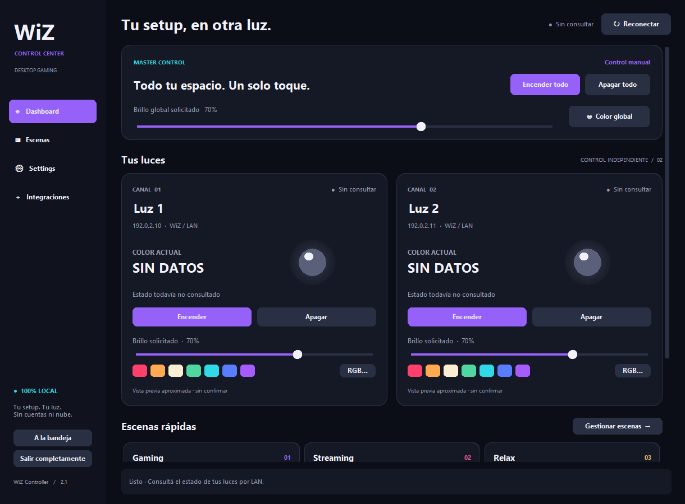

# WiZ Controller 2.1 · Desktop Gaming Edition

Aplicación Windows para controlar dos bombillas WiZ por red local desde un dashboard oscuro, la bandeja del sistema o atajos globales. Desarrollada con Python 3.13, CustomTkinter y pywizlight, sin nube, cuentas ni bases de datos.



La captura usa IP ficticias. **La versión 2.1 fue validada manualmente en Windows:** ambas bombillas conectan y responden; encendido, apagado, brillo, colores y escenas funcionan; el ejecutable abre correctamente y los atajos globales fueron probados. El usuario confirmó estabilidad de la interfaz y del control de iluminación. Las pruebas en juegos específicos, después de iniciar sesión y en otros equipos no forman parte de esa confirmación.

## Funcionalidades

- Encendido, apagado, brillo y color globales o independientes por bombilla; nombres editables y estado confirmado por lectura.
- Gaming, Streaming, Relax, Estudio y Noche; creación, edición y eliminación de escenas personales por canal.
- Bandeja real: abrir, encender/apagar ambas luces, aplicar Gaming/Streaming/Relax y salir completamente.
- Atajos globales configurables mediante `RegisterHotKey`, sin hooks, historial de teclado ni permisos de administrador.
- Una sola instancia por sesión de Windows: abrir otra vez restaura el panel existente.
- Preferencias, escenas y logs persistentes en `%LOCALAPPDATA%\WiZController`, con migración conservadora desde 2.0.
- Ejecutable sin consola generado mediante PyInstaller, con ícono propio y recursos incluidos.
- Red asíncrona, timeout, debounce, reconexión y una operación pendiente por canal. No se aumenta el polling periódico de 12 segundos.

## Requisitos

Windows 10/11 y dos bombillas WiZ con control local habilitado. PC y bombillas deben estar en la misma red, con comunicación UDP 38899. Los blancos cálido y neutro requieren temperatura ajustable. Las IP deben configurarse manualmente; se recomienda reserva DHCP en el router.

Para ejecutar el código o compilar: Python 3.13 de 64 bits con Tcl/Tk y acceso a Internet para instalar dependencias. El paquete generado incluye Python y funciona sin instalarlo en el equipo destino. La iluminación solo necesita la LAN.

## Instalar y ejecutar desde Python

En PowerShell:

```powershell
git clone https://github.com/fedechiesa/wiz-controller.git
cd wiz-controller
python -m venv .venv
.\.venv\Scripts\python.exe -m pip install -r requirements.txt
.\.venv\Scripts\python.exe main.py
```

Si ya tenés `.venv`, reutilizalo e instalá las dependencias actualizadas. Para abrir sin consola:

```powershell
.\.venv\Scripts\pythonw.exe main.py
```

En una instalación nueva, ingresá las IP de tus luces en **Settings** y guardá. Los valores públicos `192.0.2.10` y `192.0.2.11` son ficticios. Una instalación 2.0 con `data/config.json` válido se importa automáticamente si aún no existe configuración persistente; el original queda intacto.

Dependencias directas: `pywizlight==0.6.6`, `customtkinter==5.2.2`, `pystray==0.19.5` y `Pillow==13.0.0`. PyInstaller se instala únicamente para compilar, desde `requirements-build.txt`.

## Uso diario y atajos

La bandeja está habilitada inicialmente. Con **La X minimiza a la bandeja** activado, la X oculta la ventana únicamente cuando el ícono está listo. **Salir completamente**, en el panel o el menú de bandeja, siempre termina la aplicación; no envía apagado a las luces. El botón de minimizar estándar sigue usando la barra de tareas.

Los atajos vienen desactivados para evitar conflictos con tu setup. Activá **Atajos globales de Windows** en Settings, editá las combinaciones si querés y guardá:

| Acción | Combinación inicial |
| --- | --- |
| Gaming | Ctrl + Alt + F9 |
| Streaming | Ctrl + Alt + F10 |
| Relax | Ctrl + Alt + F11 |
| Alternar ambas luces | Ctrl + Alt + F8 |

F12 no se usa porque está reservada por Windows para depuración. Se aceptan Ctrl/Alt/Shift más A–Z, 0–9 o F1–F11, con al menos Ctrl o Alt. Las combinaciones repetidas se rechazan; un conflicto con otro programa se informa sin deshabilitar los otros atajos. Se usa `MOD_NOREPEAT` para evitar repetición al mantener una tecla. [Documentación de RegisterHotKey](https://learn.microsoft.com/en-us/windows/win32/api/winuser/nf-winuser-registerhotkey).

Alternar consulta primero ambas luces: si alguna está encendida, apaga las dos; si ambas están apagadas, las enciende. Si una no responde, no adivina su estado. Acciones repetidas durante una operación se descartan o conservan como una única selección pendiente; una orden explícita cancela un alternado pendiente.

Los juegos en pantalla completa exclusiva, con anticheat, a un nivel de privilegios mayor o que reserven la misma combinación pueden impedir su funcionamiento. No se instalan hooks ni se eleva la aplicación para eludir esas restricciones. Probá los atajos en tus juegos antes de depender de ellos.

[Guía de uso diario, inicio con Windows y recuperación de la bandeja](docs/DAILY_USE.md).

## Generar y ejecutar WiZController.exe

En Windows, desde el proyecto:

```powershell
.\.venv\Scripts\python.exe -m pip install -r requirements-build.txt
powershell -NoProfile -ExecutionPolicy Bypass -File scripts/build.ps1
.\dist\WiZController\WiZController.exe
```

El resultado es **`dist\WiZController\WiZController.exe`**, sin consola y con ícono propio. Distribuí **toda la carpeta `dist\WiZController`**, incluido `_internal`; el `.exe` no es un archivo autónomo. Esta estrategia evita la extracción temporal de un paquete de archivo único y favorece un inicio predecible de Tk y la bandeja. No se publican binarios automáticamente.

El build usa versiones fijadas y recursos explícitos. No recopila `data/`, configuraciones personales, ejemplos con IP reales ni directorios de desarrollo. El script verifica dependencias, ejecuta tests, genera los íconos y muestra el SHA-256 del ejecutable. [Guía de build y diagnóstico](docs/BUILD.md).

## Configuración y migración

La configuración se guarda en `%LOCALAPPDATA%\WiZController\config.json`, las escenas en `scenes.json` y el log rotativo en `controller.log`. El directorio no depende de la ubicación del ejecutable ni de dónde se ejecute. `config.example.json` y `scenes.example.json` son ejemplos sin información personal.

Al ejecutar desde Python se busca la configuración anterior en `data/` del proyecto; en modo empaquetado, en `data/` junto al ejecutable. Se copian solo `config.json` y `scenes.json` válidos que aún no existan en el destino, sin borrar originales ni reemplazar archivos existentes. Los logs anteriores permanecen en su ubicación original. No se importa nada desde `_internal` ni desde el directorio de trabajo por defecto.

También podés importar una carpeta anterior explícitamente:

```powershell
.\.venv\Scripts\python.exe main.py --migrate-from .\data
```

Una vez migrado, las modificaciones se guardan en el nuevo directorio. Editar el viejo `data/config.json` ya no cambia la configuración activa. Un JSON inválido se conserva y se informa; no se sobrescribe silenciosamente. Los nombres `bulb1` y `bulb2` identifican los canales aunque cambies nombre o IP.

Settings conserva las preferencias de apariencia, escena de inicio, bandeja, atajos e inicio con Windows. Esta última opción usa una sola entrada propia en `HKCU\Software\Microsoft\Windows\CurrentVersion\Run`. Al guardar con la opción activa se actualiza a la ruta actual de Python o del ejecutable; al desactivarla se elimina esa entrada. No se requiere administrador ni se modifica OBS.

## Tests y validación

```powershell
.\.venv\Scripts\python.exe -m unittest discover -s tests -v
```

Para incluir widgets reales y API nativa en una sesión Windows de escritorio:

```powershell
$env:WIZ_GUI_TESTS = '1'
$env:WIZ_NATIVE_TESTS = '1'
.\.venv\Scripts\python.exe -m unittest discover -s tests -v
Remove-Item Env:WIZ_GUI_TESTS, Env:WIZ_NATIVE_TESTS
```

Los tests nativos muestran un ícono temporal y registran combinaciones de prueba Ctrl+Alt+Shift+F8–F11; las liberan al terminar. No envían órdenes a bombillas ni cambian el inicio automático. Una comprobación básica sin red:

```powershell
.\.venv\Scripts\python.exe main.py --smoke-test --data-dir .\build\smoke
.\.venv\Scripts\python.exe -m compileall -q main.py wiz_controller tests scripts
.\.venv\Scripts\python.exe -m pip check
```

[Resultados automatizados, validación manual de 2.1 y comprobaciones adicionales pendientes](docs/VALIDATION.md).

## Estructura y privacidad

`lighting.py` conserva la comunicación WiZ existente. `runtime.py` ejecuta asyncio fuera de Tk; bandeja y teclado publican acciones en una cola consumida por la interfaz. `desktop.py` supervisa inicio, reconfiguración y cierre de esas integraciones. `paths.py`, `storage.py` e `instance.py` resuelven rutas persistentes, migración e instancia única.

El repositorio contiene código, tests, recursos, ejemplos y documentación. `.gitignore` excluye `.venv/`, cachés, `data/`, logs, archivos de credenciales, `build/`, `dist/` y ejecutables. Revisá también capturas y cambios antes de publicar: `.gitignore` no elimina información pegada dentro de un archivo público.

OBS y eventos del stream quedan fuera de esta versión. La siguiente fase podrá incorporarlos mediante adaptadores, conservando como base la versión 2.1 validada.
